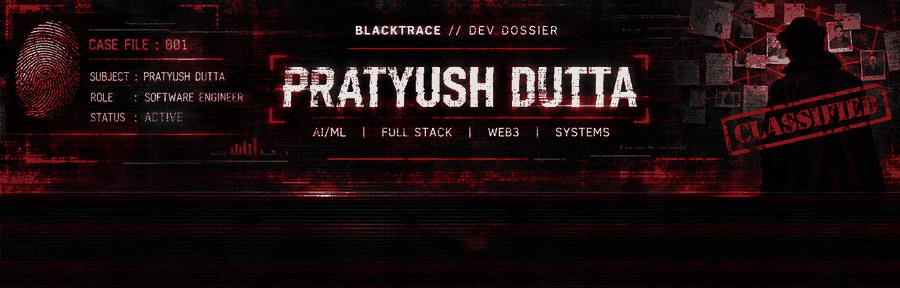

# BLACKTRACE — Phase 1 asset guide

## Visual system
- Background: `#08090D`
- Surface: `#151018`
- Primary red: `#E3263B`
- Deep red: `#8F0718`
- Terminal green: `#00FF9C`
- Amber: `#FFB84D`
- Main text: `#F3ECEE`
- Muted text: `#B8AEB1`

## Files
- `blacktrace-banner.gif` — animated GIF; preferred README hero for broad compatibility.
- `blacktrace-banner.svg` — vector banner with an SVG scan-line animation. GitHub may sanitize or render SVG animation differently; keep the GIF as the reliable fallback.
- `blacktrace-banner-base.jpg` — static base artwork.
- `case-divider.svg` — reusable section divider.

## Suggested README embed
```html
<p align="center">
  <picture>
    <source media="(prefers-reduced-motion: reduce)" srcset="./assets/blacktrace-banner-base.jpg">
    
  </picture>
</p>
```

For a direct SVG test, use `./assets/blacktrace-banner.svg` as the image source in a preview branch. The GIF remains the safer primary banner on GitHub.

## Notes
- The GIF uses a moving red scan beam and brief interference bars.
- Avoid putting important biography text only inside the image; repeat it in accessible Markdown below the banner.
- Keep motion decorative and ensure the rest of the profile remains readable.
