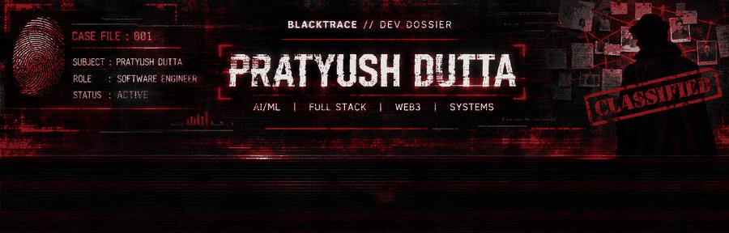
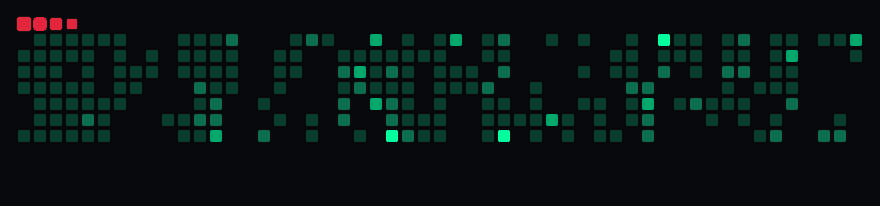

<!-- 

<p align="center">

</p>

<p align="center">

</p>

---

# 👋 Hi, I'm Pratyush Dutta

🧑‍💻 Passionate about **AI, Web Development & Web3**

---

# 🧑‍💻 About Me

- 🧑‍🎓 Student at **Asansol Engineering College**
- 🌱 Currently learning **Full Stack**
- 🚀 Always exploring **AI Developer Tools**

---

# 🌐 Connect With Me

<p align="center">

<a href="https://www.instagram.com/_pratyush.06_/" target="_blank">

</a>

<a href="https://www.linkedin.com/in/pratyush-dutta-221b94302/" target="_blank">

</a>

<a href="https://devfolio.co/@Pratyush06" target="_blank">
  
</a>

<a href="https://discord.gg/csqz8EEv" target="_blank">

</a>

<a href="https://wa.me/917810983647" target="_blank">
  
</a>

<a href="https://x.com/pd_0406official" target="_blank">

</a>

</p>

---

# 🛠 Tech Stack

<p align="center">


<br/><br/>

<!-- Streamlit -->
<!-- <a href="https://streamlit.io/" target="_blank">
  
</a>

<!-- Antigravity (fun/experimental) -->
<!-- <a href="https://elgoog.im/gravity/" target="_blank">
  
</a> -->

<!-- Cursor IDE -->
<!-- <a href="https://cursor.sh/" target="_blank">
  
</a> -->

<!-- <a href="https://www.heroku.com/" target="_blank">
  
</a>

<a href="https://getbootstrap.com/" target="_blank">
  
</a>

<a href="https://n8n.io/" target="_blank">
  
</a> -->

<!-- </p>

---

# 📊 GitHub Analytics

<p align="center">


 -->

<!-- </p>

<p align="center">


</p>


---

# 🏆 GitHub Achievements -->

<!-- <p align="center">


</p>

---

# 🎟 Holopin Badges

<p align="center">

<a href="https://holopin.io/@pratyush06-aec">

</a>

</p> -->

--- -->

<!-- # 🐍 Contribution Snake

<p align="center">


</p>

--- -->

<!-- *Thanks for visiting my profil!* -->

<!-- *If you liked it, please give a ⭐!* -->


<!-- ------------------------------------------------------------ -->
<!-- NEW VERSION -->
<!-- ----------------------------------------------------------- -->


<!-- ================================================= -->
<!-- BLACKTRACE // CLASSIFIED DEVELOPER DOSSIER        -->
<!-- SUBJECT: PRATYUSH DUTTA                            -->
<!-- ================================================= -->

<p align="center">
  
</p>

<p align="center">
  
</p>

<p align="center">
  
</p>

---

<h2 align="center">01 // INVESTIGATOR PROFILE</h2>

```text
╔══════════════════════════════════════════════════════╗
║             CLASSIFIED SUBJECT RECORD               ║
╠══════════════════════════════════════════════════════╣
║ SUBJECT       : PRATYUSH DUTTA                      ║
║ DESIGNATION   : SOFTWARE ENGINEER IN THE MAKING     ║
║ SPECIALIZATION: AI / ML / FULL STACK / WEB3         ║
║ INSTITUTION   : ASANSOL ENGINEERING COLLEGE         ║
║ LOCATION      : INDIA                               ║
║ STATUS        : ACTIVELY BUILDING                   ║
╚══════════════════════════════════════════════════════╝
```

### Hello, I'm Pratyush Dutta.

I'm a Computer Science Engineering student specializing in AI & ML, passionate about building intelligent applications, exploring emerging technologies and engineering solutions to real-world problems.

- AI/ML and intelligent systems
- Full-stack and backend development
- AI agents and developer tools
- Web3 and decentralized technologies
- Open-source communities and hackathons

---

<h2 align="center">02 // ACTIVE INVESTIGATIONS</h2>

<p align="center">
  <i>Every project starts with a problem worth investigating.</i>
</p>

| CASE ID | PROJECT | DOMAIN |
|:---:|---|---|
| 001 | AAVYA / PCOS Prediction | Healthcare AI |
| 002 | flora_carbon_ai | Carbon World |
| 003 | Nobodristhi | ML / Tech_News |
| 004 | my-courier | AI Agent |

---

<h2 align="center">03 // TECH ARSENAL</h2>

### Programming Languages

<p align="center">
  
</p>

### Frameworks & Development

<p align="center">
  
</p>

### Databases & Infrastructure

<p align="center">
  
</p>

---


<h3 align="center">04A // REPOSITORY INTELLIGENCE</h3>

<p align="center">
  <i>CLASSIFIED PROJECT REGISTRY // SELECTED INVESTIGATIONS</i>
</p>

<p align="center">
  
</p>

<p align="center">
  <a href="https://github.com/pratyush06-aec/flora_carbon_ai">
    FLORA CARBON AI
  </a>
  &nbsp; // &nbsp;
  <a href="https://github.com/pratyush06-aec/my-courier">
    MY-COURIER
  </a>
  &nbsp; // &nbsp;
  <a href="https://github.com/pratyush06-aec/Nobodristhi">
    NOBODRISHTI
  </a>
  &nbsp; // &nbsp;
  <a href="https://github.com/pratyush06-aec/AAVYA-HeredityAI-for_women_health_risk_prediction">
    AAVYA / PCOS Prediction
  </a>
  &nbsp; // &nbsp;
  <a href="https://github.com/pratyush06-aec/callmi">
    callmi
  </a>
</p>


---


<h2 align="center">05 // DIGITAL FOOTPRINT</h2>

<p align="center">
  
</p>


---

<h2 align="center">06 // SECURE COMMUNICATION</h2>

<p align="center">
  <a href="https://www.linkedin.com/in/pratyush-dutta-221b94302/">
    LinkedIn
  </a>
  &nbsp; // &nbsp;
  <a href="https://www.instagram.com/_pratyush.06_/">
    Instagram
  </a>
  &nbsp; // &nbsp;
  <a href="https://x.com/pd_0406official">
    X
  </a>
  &nbsp; // &nbsp;
  <a href="https://devfolio.co/@Pratyush06">
    Devfolio
  </a>
</p>

<p align="center">
  <b>CONNECTION STATUS: AVAILABLE</b>
</p>

<p align="center">
  
</p>

<p align="center">
  <b>BLACKTRACE // END OF FILE</b>
  <br/>
  <i>Investigation continues. See you in the next commit.</i>
</p>
